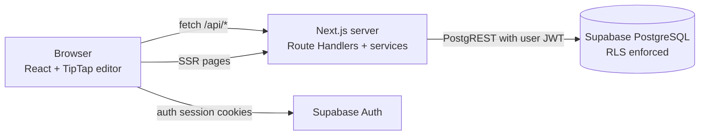

# Paperstack — Architecture Note

## 1. System overview

Paperstack is a Next.js (App Router) single-app deployment on Vercel, backed by Supabase (PostgreSQL + Auth). The browser never talks to PostgreSQL directly for privileged work: pages are server-rendered where data must be authorized server-side, and interactive features call Route Handlers under `/api/documents/*`, which run inside the Next.js server with the user's Supabase session cookie attached.

Key layers:

- `src/app/(workspace)` — server components that fetch authorized data and render client components.
- `src/app/api/documents/**` — Route Handlers: validation (Zod), session resolution, service calls.
- `src/services/documents.ts` — business logic + authorization (permission evaluation, share management).
- `src/lib/supabase` — SSR cookie-aware clients (`@supabase/ssr`). No service-role key is used anywhere; every query runs with the caller's JWT so RLS is always in force.
- `src/lib/import/parsers.ts` — TXT / Markdown / DOCX import conversion.
- `src/lib/validation/schemas.ts` — Zod schemas shared by API routes and tests.

## 2. Document lifecycle

Create → the dashboard POSTs `/api/documents`; the server resolves the session user, inserts a row owned by that user with a default title (`Untitled document`) and a valid empty TipTap doc, then the client routes to `/documents/{id}`. Duplicate-click protection: the create button disables while in flight and the `?new=1` one-shot effect removes its query param immediately.

Edit → the TipTap editor holds the document as structured JSON. `update` events queue a debounced (800 ms) save; the editor serializes `getJSON()` and PATCHes `{ title?, content? }`.

Reopen → the document page is a server component: it resolves the user, calls `getAuthorizedDocument`, and passes role (`owner`/`editor`/`viewer`) into the client editor, which initializes TipTap from the stored JSON. Formatting survives refresh because the same JSON is fed back into the editor — no HTML round-trip.

Delete → DELETE `/api/documents/{id}`; server-side owner check; shares are removed by `on delete cascade`.

## 3. Rich-text persistence

The `documents.content` column is JSONB storing TipTap's ProseMirror JSON. Reasons:

- Round-tripping HTML→TipTap→HTML is lossy and invites sanitization issues.
- Structured JSON is directly re-hydratable into the editor, so reload is exact.
- Zod validates the shape (`type: "doc"`, nested block/inline nodes) before persistence, so malformed payloads are rejected at the API boundary.

## 4. Sharing model

`document_shares(document_id, shared_with, permission)` with a unique `(document_id, shared_with)` constraint, `permission ∈ {viewer, editor}`, and `shared_by <> shared_with` (no self-shares). Only the owner can create/update/revoke shares — enforced both in `services/documents.ts` and by RLS policies that check document ownership via a subquery. Recipients are resolved server-side through the `get_user_id_by_email` security-definer SQL function (never by trusting a client-supplied user ID).

- viewer: read-only editor (`editable: false`), no rename, no delete, no share management.
- editor: can PATCH content/title but cannot delete, re-share, or manage collaborators.

## 5. Authorization

Authorization is enforced twice, deliberately:

1. Server-side checks in services (owner/editor/viewer evaluation from the authenticated user id, plus share lookups) produce correct 403/404 responses.
2. RLS policies on `documents`, `document_shares`, and `profiles` provide defense in depth — even a hypothetical client-side query path cannot read or mutate other users' rows because all clients use the anon key + user JWT (never the service-role key).

Inaccessible documents return `404` (not 403) to avoid leaking existence.

## 6. File import

`POST /api/documents/import` accepts multipart form data:

- Size limit 5 MB enforced server-side (413), empty-file rejection, extension + MIME checks (415), DOCX magic-byte check (`PK\x03\x04`), TXT replacement-character heuristic for non-UTF8 payloads.
- `.txt` — decoded as UTF-8, split on blank lines into paragraphs.
- `.md` — parsed with `marked`'s lexer into headings/paragraphs/bold/italic/lists; raw HTML blocks are deliberately ignored (never rendered as trusted HTML).
- `.docx` — parsed with `mammoth` (`convertToHtml`), then converted with a minimal trusted-tag-only parser (p, h1–h6, strong/em/b/i/u, ul/ol/li). Complex Word features (tables, images, tracked changes, layout) are not preserved and are documented as limitations.

All processing is in memory; nothing is written to disk. Errors return actionable messages without stack traces or server paths.

## 7. Tradeoffs

- **No real-time collaboration / cursors** — out of scope; autosave sequencing gives last-writer-wins correctness without the cost of CRDTs.
- **404-over-403 for inaccessible docs** — prevents existence leaks; tradeoff is slightly less diagnostic detail for legitimate-but-unauthorized callers.
- **Last-writer-wins autosave with request sequencing** — saves are serialized (one in-flight PATCH, latest payload flushed after) so an older response can never overwrite newer content; a full OT/version-vector system was unnecessary at this scale.
- **No file storage** — imports are parsed in memory, so no storage bucket or public upload directory exists to secure.
- **Email lookup via SQL function** rather than a service-role admin client — keeps secrets minimal; the function is security-definer and only exposes id/email/display_name of an exact email match to authenticated callers.
